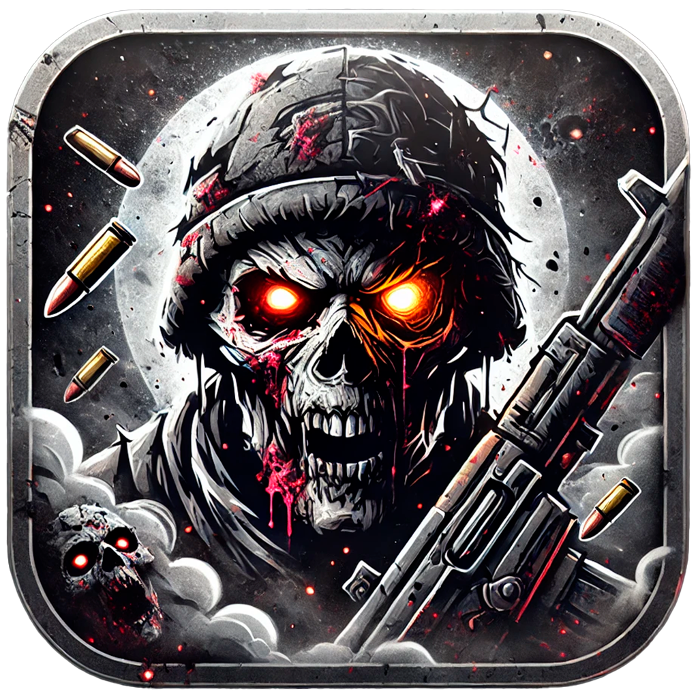

# Zombie Chaos — Game Design Document

**Instituto Federal do Amazonas (IFAM) — Campus Manacapuru**  
Projeto de Conclusão de Curso Técnico (PCCT)  
Orientador: Walter Claudino da Silva Junior  
Documento 1.0.0 · Manacapuru · 2026  
Base técnica: `main`, commit `d5c554a02181d6a6082818a5be659acf51059df9`

## Sumário

1. [Informações gerais do projeto](#informacoes-gerais)
2. [High Concept](#high-concept)
3. [Visão geral do jogo](#visao-geral)
4. [Mecânicas do jogo](#mecanicas)
5. [Narrativa](#narrativa)
6. [Design de fases e Level Design](#level-design)
7. [Interface do usuário](#interface)
8. [Direção de arte](#arte)
9. [Áudio](#audio)
10. [Requisitos técnicos](#requisitos)
11. [Inteligência artificial](#ia)
12. [Plano de produção](#producao)
13. [Testes](#testes)
14. [Análise de viabilidade](#viabilidade)
15. [Considerações finais](#consideracoes)

<a name="informacoes-gerais"></a>

# 1. Informações gerais do projeto

## 1.1 Título do jogo

**Zombie Chaos**, nome de produto registrado nos Player Settings.

## 1.2 Gênero

Tiro em primeira pessoa (FPS) de ação e sobrevivência em arena, com temática de horror. A partida é local e tem um único personagem controlado pelo jogador.

## 1.3 Plataforma

PC com Windows é a plataforma demonstrada. O histórico do projeto inclui relato de abertura de um executável Windows, após demora na inicialização. Esse relato não constitui homologação desta revisão nem estabelece compatibilidade por configuração de hardware. Não há evidência de uma edição móvel ou de um fluxo completo para outros sistemas.

## 1.4 Público-alvo

**A confirmar pela equipe.** Pelo formato de partida e pelos comandos, pode-se inferir afinidade com pessoas interessadas em FPS de sobrevivência para computador. A inferência descreve o perfil de interesse, sem definir faixa etária, alcance comercial ou requisitos de experiência prévia.

## 1.5 Classificação indicativa

**Estimativa preliminar de 16 anos, sujeita a avaliação oficial.** A estimativa é conservadora e se fundamenta nos disparos repetidos contra criaturas humanoides, sangue nos impactos e possibilidade de abates na cabeça, junto à ambientação de horror. Intensidade visual e sonora devem ser avaliadas na build completa. A estimativa não constitui classificação oficial.

## 1.6 Equipe

**Tabela 1 — Créditos registrados no menu principal**

| Integrante | Função creditada |
|---|---|
| Juan Gabriel Ramirez Gonçalves | Desenvolvimento e UX/UI |
| Angie Lisset Quiñones Montenegro | UX/UI e Level Design |
| Walter Claudino da Silva Junior | Orientador |

Fonte: painel de créditos em `Assets/Cenas/MenuPrincipal.unity` da revisão auditada.

## 1.7 Versão do documento

**1.0.0**, versão editorial deste GDD. A revisão do software é identificada operacionalmente pelo commit. O Player Settings declara `bundleVersion: 1.0.0`, enquanto o menu exibe “VERSÃO 9.4.7”. A denominação pública a adotar é **a confirmar**.

## 1.8 Data

20 de novembro de 2026. Data da documentação, independente da data de entrega acadêmica e da publicação do jogo.

<a name="high-concept"></a>

# 2. High Concept — Conceito central

## 2.1 Ideia principal do jogo

Em uma arena industrial escura, o jogador enfrenta criaturas que surgem em grupos e se aproximam por rotas navegáveis. O combate em primeira pessoa alterna movimentação, escolha de alvos, recarga e deslocamento até pontos de compra. As eliminações rendem pontos para equipar armas ou repor munição durante a própria partida.

## 2.2 Diferencial competitivo

A identidade da proposta vem da combinação entre **ondas governadas pelo tempo, recuperação de vida na virada da onda e loja localizada no mapa**. Eliminar um grupo cedo dá espaço para se reposicionar ou comprar, enquanto inimigos restantes podem se acumular. A loja exige deslocamento e interrompe os controles do jogador durante a escolha, com o relógio da arena ainda ativo. Esses elementos descrevem a proposta interna do jogo. Uma vantagem perante concorrentes dependeria de pesquisa comparativa.

## 2.3 Objetivo do jogador

Permanecer vivo, avançar no maior número de ondas possível e acumular eliminações. Os pontos têm função de saldo para compras e a tela de derrota apresenta a onda alcançada e o total de monstros derrotados.

## 2.4 Experiência pretendida

A leitura de design aponta para pressão crescente combinada com decisões curtas de posicionamento e consumo de recursos. O cronômetro permite antecipar a próxima leva e a recuperação de vida, enquanto os sons de disparo, a indicação de dano e o feedback de acerto fatal dão resposta às interações. O efeito dessa combinação sobre tensão e legibilidade requer observação em partida.

<a name="visao-geral"></a>

# 3. Visão geral do jogo

## 3.1 Proposta do projeto

### 3.1.1 Problema ou necessidade que o projeto aborda

No contexto do PCCT, a necessidade técnica identificada é reunir sistemas de tempo real em uma partida demonstrável, com regras rastreáveis desde a entrada do jogador até os efeitos de combate e a interface. O produto atende a um objetivo de entretenimento em arena.

### 3.1.2 Experiência entregue ao jogador

O projeto liga um menu inicial a uma arena jogável em primeira pessoa. O jogador recebe informações de saúde, stamina, munição, pontos e onda, enfrenta criaturas e decide quando gastar recursos. Comandos, sons e indicadores fazem parte da implementação observada. A qualidade da experiência e a estabilidade de uma sessão completa precisam de verificação em execução.

## 3.2 Objetivos do projeto

### 3.2.1 Objetivo técnico

Integrar câmera, controle FPS, combate por colisão, navegação de inimigos, geração temporal, economia e UI em uma partida local, com configurações persistidas. O objetivo sintetiza as capacidades do projeto examinadas nesta auditoria.

### 3.2.2 Objetivo educacional

O caráter educacional é a demonstração acadêmica de integração de sistemas em Unity e C#, adequada ao PCCT. Uma finalidade pedagógica dirigida ao público do jogo é inaplicável ao escopo observado, que não contém mecânicas de ensino.

### 3.2.3 Objetivo de mercado

**A confirmar.** Não foi encontrada definição verificável de comercialização, preço, distribuição pública ou indicadores de adoção.

<a name="mecanicas"></a>

# 4. Mecânicas do jogo

## 4.1 Gameplay

### 4.1.1 Interações do jogador

**Movimento e câmera.** `MovimentoJogador` lê os eixos legados, projeta a direção relativa à câmera e movimenta o `CharacterController`. A velocidade base serializada é 2,6 unidades por segundo, com fator 2 enquanto há stamina e o Shift esquerdo está pressionado. A stamina usa escala interna de até cerca de 2 e é normalizada para a interface. O código recupera esse recurso ao soltar a corrida. A drenagem pode ocorrer com Shift pressionado mesmo sem deslocamento. O pulo aplica velocidade vertical de 4,5 após teste de chão por esfera na camada `Cenario`. A Cinemachine usa os eixos Mouse X e Mouse Y para a rotação. Passos, salto e animações das armas respondem ao movimento.

**Disparo e mira.** `GerenciadorDeArmas` controla cadência e impede disparos durante recarga, troca ou corrida efetiva. Pressionar Fire1 continuamente permite disparos à cadência configurada, inclusive com a pistola. Cada disparo consome uma unidade do carregador e lança um único raio pelo eixo da câmera, com alcance técnico de 1.000 unidades e exclusão de triggers. A shotgun também usa um raio por disparo. O sistema aciona animação, clarão, áudio e impulso de câmera. O recuo usa um padrão cíclico no Pan/Tilt. A mira alterna o parâmetro `Mirar` do Animator e a retícula do HUD.

**Dano e recursos.** Em um colisor com `ParteDoCorpo`, o nível baixo, médio ou alto seleciona o dano da arma. Acima da distância configurada, o código multiplica o dano pelo fator próprio da arma e converte o resultado para inteiro. O impacto gera efeito de sangue. Um impacto válido em outra superfície gera o efeito de colisão. O abate ocorre quando `VidaInimigo` chega a zero e emite seu evento de morte.

**Tabela 2 — Armas configuradas em `Game.unity`**

| Arma | Tiros/s | Carregador / reserva cheia | Dano B/M/A | Limiar / fator após limiar | Espera de recarga |
|---|---:|---:|---:|---:|---:|
| Pistola | 2 | 8 / 48 | 20/40/100 | 8 / 0,10 | 2,3 s |
| Shotgun | 1 | 5 / 48 | 80/140/200 | 6 / 0,25 | 1 s por espera |
| M4A1 | 8 | 35 / 70 | 50/70/120 | 20 / 0,70 | 2,1 s |
| SMG45 | 5 | 24 / 48 | 35/55/100 | 15 / 0,65 | 2,5 s |
| AK47 | 7 | 30 / 70 | 25/75/160 | 20 / 0,60 | 3,1 s |
| LMG | 10 | 45 / 90 | 30/60/150 | 10 / 0,40 | 5,6 s |

Valores de cena, em unidades Unity para os limiares. São parâmetros de balanceamento, não resultados medidos. A LMG tem a maior cadência e capacidade de carregador, mas perde 60% do dano após 10 unidades. A M4A1 conserva 70% depois de 20 unidades. Essas diferenças favorecem usos distintos sem implicar superioridade global.

**Recarga e equipagem.** A recarga começa com R ou quando o carregador está vazio e ainda há reserva. A maioria das armas transfere munição ao fim da espera, enquanto a shotgun tem espera inicial e inserções sucessivas de uma unidade. A fórmula atual é `min(capacidade, reserva) − munição atual`, o que limita indevidamente ou pode inverter a transferência em recargas parciais com pouca reserva. O comportamento nessa borda é parcialmente implementado. A pistola ocupa o slot principal e a compra substitui a arma secundária. Trocar utiliza a animação de abaixar e levantar o modelo. O fim da rotina envia ao HUD a arma anterior, com possível leitura desatualizada até a próxima atualização de munição.

**Loja.** Duas instâncias do prefab `AreaDeCompra` ativam a interação por tag `Loja`. A tecla F abre o painel quando o jogador está na área. Os cartões consultam o saldo ao aparecer e repetem a verificação antes da transação. Comprar munição repõe a reserva daquela arma ao teto, sem encher diretamente o carregador. A compra fecha o painel e toca um clique. A abertura libera o cursor e desabilita movimento, combate e a câmera controlada, com a simulação continuando. Comprar arma e comprar munição são ações independentes. A compra não mantém uma coleção cumulativa de armas equipáveis em múltiplos slots.

### 4.1.2 Loop principal de jogabilidade

1. Entrar em `Game` com 100 de vida, 5.000 pontos e a pistola como arma principal.
2. Receber a primeira leva de inimigos e identificar ameaças pelo cenário e pelo áudio.
3. Circular pela arena, mirar, disparar e administrar distância, stamina e munição.
4. Eliminar criaturas, receber pontos e decidir entre continuar o confronto ou ir até uma área de compra.
5. Comprar ou recarregar conforme a situação e preparar-se para a próxima sub-onda.
6. Ao término do intervalo, avançar de onda, restaurar a vida e repetir o ciclo enquanto sobreviver.

### 4.1.3 Condições de vitória

Inaplicável como desfecho formal. A rotina de ondas repete por tempo, sem contador terminal ou teste de que todos os inimigos morreram. O objetivo é superar a própria marca na sessão. Não há mecanismo identificado de vitória, ranking ou recorde persistente.

### 4.1.4 Condições de derrota

Ao chegar a zero de vida, `Jogador` marca a morte, fixa `Time.timeScale = 0` e abre `GameOverPanel`. A interface libera o cursor e apresenta a onda e os abates. **Finalizar** carrega novamente o menu principal e restaura a escala de tempo por `MenuConfiguracoes.CarregarNovaCena`.

## 4.2 Controles

**Tabela 3 — Controles vinculados ao fluxo de jogo**

| Ação | Dispositivo | Comando | Finalidade |
|---|---|---|---|
| Mover | Teclado | WASD ou setas | Deslocamento relativo à câmera |
| Olhar | Mouse | Movimento nos eixos X/Y | Rotacionar a visão |
| Correr | Teclado | Shift esquerdo | Dobrar a velocidade enquanto houver stamina |
| Pular | Teclado | Espaço | Saltar com contato de chão |
| Atirar | Mouse ou teclado | Botão esquerdo ou Ctrl esquerdo | Disparar conforme cadência e estado da arma |
| Mirar | Mouse | Botão direito | Alternar a animação de mira e a retícula |
| Recarregar | Teclado | R | Transferir munição da reserva |
| Trocar arma | Teclado | 1 ou 2 | Selecionar arma principal ou secundária disponível |
| Interagir com a loja | Teclado | F | Alternar painel dentro do trigger de compra |
| Abrir menu de pausa | Teclado | Esc | Suspender controles e abrir opções |
| Acionar a interface | Mouse | Clique | Selecionar botões, opções, barras e cartões |
| Mover e disparar | Controle | Eixos legados 1/2 e botão lógico 0 | Entradas parciais habilitadas no Input Manager |

As associações de controle são lógicas e dependem do dispositivo. A configuração parcial de eixos e Fire1 ainda não cobre mira, loja, recarga e comandos de partida de forma verificável. Touch e joystick virtual não integram o fluxo auditado. `Assets/InputSystem_Actions.inputactions` existe e a configuração de entrada permite ambos os sistemas, porém o código de partida e a câmera auditados usam a entrada legada.

## 4.3 Sistema de pontuação

O saldo inicial de 5.000 é configurado na cena. Cada inimigo tem recompensa própria em `VidaInimigo`. Apenas a primeira transição de vivo para morto concede o abate. Um golpe fatal de dano alto dobra a recompensa e aciona texto e áudio de headshot. A pontuação aumenta pela eliminação, é descontada nas compras e aparece no HUD com indicação animada de acréscimo. O contador de abates é independente do saldo.

**Tabela 4 — Custos configurados na loja**

| Arma | Equipar | Repor reserva |
|---|---:|---:|
| Pistola | 500 | 200 |
| Shotgun | 700 | 300 |
| M4A1 | 1.400 | 400 |
| SMG45 | 1.000 | 400 |
| AK47 | 1.400 | 400 |
| LMG | 2.000 | 400 |

A pistola herda os valores do prefab `ArmaCard`. Os demais cartões usam sobrescritas em `Game.unity`. A lógica verifica saldo, mas admite gasto ao selecionar a arma já equipada ou repor uma reserva que já está cheia. Não foram identificados aprimoramentos permanentes, inventário de itens coletáveis, recompensas por tempo ou conversão de saldo em progressão entre partidas.

## 4.4 Sistema de progressão

Na onda (n), o gerador define a duração em **30 + 5n segundos** e o total nominal como o teto de **5 × ln(n + 1)**. Divide a duração em um número de sub-ondas equivalente ao teto de duração/20. A primeira leva é imediata e as seguintes têm intervalos iguais. A expressão de quantidade por leva divide dois inteiros antes de arredondar. Assim, o total efetivo pode ser menor que o nominal. Por exemplo, na onda 3 o total nominal é 7 e a divisão em três levas produz dois inimigos por leva, totalizando 6.

O conjunto elegível cresce pelo limite exclusivo `min(n/2, 5)`, com divisão inteira. Na onda 1 o intervalo inteiro vazio retorna zero e seleciona o primeiro prefab. A composição é sorteada a cada instanciação. A vida é reposta na virada, mas o gerador não elimina inimigos sobreviventes nem aplica multiplicadores aos atributos dos prefabs. A progressão concentra-se na sessão. O algoritmo não prevê onda final ou limite explícito de inimigos ativos.

<a name="narrativa"></a>

# 5. Narrativa

## 5.1 História base

A premissa verificável é sobreviver a criaturas hostis em uma arena. As cenas de build não apresentam introdução narrativa, diálogo, missões ou explicação da origem das criaturas. A definição de uma história, caso a equipe a considere necessária, depende de decisão autoral sobre o contexto do confronto e a identidade do jogador.

## 5.2 Ambientação

O conjunto industrial de vias, cercas, estruturas de concreto e contêineres, associado à iluminação escura e à presença de criaturas, sustenta uma leitura de horror. Essa leitura visual oferece contexto ambiental sem fixar uma localidade ficcional, um evento histórico ou a causa do conflito.

## 5.3 Personagens

O protagonista é funcionalmente o objeto `Jogador`, sem nome, biografia ou falas confirmadas. Zombie, ZombieMutante, Aranha, Migo e Lobisomem são os nomes técnicos das ameaças no jogo. Os prefabs e suas diferenças de comportamento caracterizam papéis de combate. Não foram identificados NPCs de diálogo ou personagens com arco documentado.

<a name="level-design"></a>

# 6. Design de fases e Level Design

## 6.1 Descrição de cada fase ou mapa

**MenuPrincipal.** Cena de entrada com câmera animada, cenário industrial `Map_v1`, iluminação, áudio ambiente e interface. A presença de cenário 3D no menu liga visualmente a entrada à arena e implica custo de carregamento a medir.

**Game.** Única arena habilitada. A hierarquia `Map_v1` reúne trechos de vias, cercas, barreiras de concreto e contêineres. Esses elementos organizam corredores, interseções, limites e interrupções na linha de visão. As duas áreas de compra são pontos de interesse funcionais em torno dos quais o jogador precisa se posicionar. As duas superfícies com NavMesh pré-calculada dão suporte ao deslocamento dos inimigos. Há **49 referências** de spawn em cena e o código rejeita pontos a menos de 15 unidades do jogador. Essa distância não assegura que o ponto fique fora do campo de visão.

As outras 20 cenas em `Assets` não fazem parte da lista de build, incluindo cenas de demonstração de pacotes. A cena `Map_v2` presente nos recursos industriais não comprova uma segunda arena jogável.

## 6.2 Curva de dificuldade

A pressão vem da combinação de frequência, variedade, resistência dos prefabs e sobreviventes acumulados. A elegibilidade de inimigos aumenta por faixas. A duração das ondas aumenta linearmente e a quantidade nominal cresce de forma logarítmica, por isso a densidade por segundo não tem crescimento monotônico garantido. A vida recuperada a cada virada e o saldo inicial alto oferecem margem de recuperação. A dificuldade percebida, o efeito da geometria e o equilíbrio desse saldo ainda precisam de sessões documentadas.

## 6.3 Elementos introduzidos por fase

**Tabela 5 — Primeira elegibilidade no sorteio**

| Onda | Elemento recém-elegível | Pressão de design inferida |
|---|---|---|
| 1 | Zombie | Ensina a administrar distância do perseguidor corpo a corpo |
| 4 | ZombieMutante | Aumenta a demanda de munição pela vida maior |
| 6 | Aranha | Amplia a variedade visual e a leitura do alvo, com vida menor |
| 8 | Migo | Introduz intenção de ameaça à distância |
| 10 | Lobisomem | Introduz a maior reserva de vida dos prefabs auditados |

Elegibilidade não garante aparição na primeira onda de cada faixa. O mapa não muda em resposta à onda e os pontos de compra existem desde o início da sessão.

<a name="interface"></a>

# 7. Interface do usuário — UI/UX

## 7.1 Tela inicial

A entrada do build é a própria cena `MenuPrincipal`. O título e a versão são apresentados sobre o cenário 3D. Não há uma tela inicial independente na lista de cenas. A latência até os botões ficarem disponíveis deve ser medida separadamente do tempo de abertura do processo.

## 7.2 Menu principal

**Jogar** aciona `CarregarNovaCena(1)`. **Configurações** expõe sensibilidade, áudio e qualidade. **Salvar** grava preferências. O retorno do painel principal recarrega os valores gravados. **Sair** aciona `Application.Quit`. O botão **Créditos** abre o painel com as funções da equipe e a instituição. O evento **Voltar** reativa as configurações e devolve o foco ao botão, preservando ajustes que ainda estão na interface. As ligações de abertura e retorno são eventos serializados em `MenuPrincipal.unity`.

Na arena, Esc abre o menu de pausa, com opções de continuar, configurar ou sair para o menu principal. Pausa e loja suspendem os controles do personagem e liberam o cursor. Ondas e IA continuam em execução porque essas rotinas não alteram a escala de tempo. A palavra “pausa” pode criar uma expectativa diferente do comportamento atual, o que deve ser observado em teste.

As configurações usam sliders para sensibilidade e volume e um seletor com os níveis Baixo, Médio e Alto. O volume afeta o `AudioListener`. A sensibilidade altera os ganhos legados do Cinemachine quando existe referência à câmera da partida. A qualidade seleciona o perfil HDRP correspondente.

## 7.3 Tela de jogo e HUD

O HUD mostra saúde, munição atual/reserva, retícula, saldo, onda e contagem regressiva. A barra de stamina aparece quando o valor normalizado fica abaixo de 0,99. Indicadores temporários destacam pontos recebidos e headshots. O dano ativa um volume de pós-processamento e sons associados. O prompt **F / Abrir** sinaliza a área de compra. Os cartões do painel mostram armas e opções de aquisição e reposição. Botões ficam indisponíveis quando o saldo não cobre o preço.

A hierarquia combina indicadores fixos, feedback transitório e painéis que assumem o foco do cursor. O texto das reservas e a leitura do cronômetro devem ser avaliados em resolução reduzida, especialmente sob contraste de efeitos de dano.

## 7.4 Tela de Game Over e vitória

O painel **GAME OVER** aparece na derrota, informa a onda atingida e o número de monstros derrotados e apresenta **Finalizar**. A tela de vitória é inaplicável à regra atual de sobrevivência sem encerramento por sucesso.

## 7.5 Wireframes

Os esquemas a seguir são **propostas de representação estrutural** baseadas nos componentes serializados. Representam agrupamentos e transições, sem reproduzir posições, proporções ou capturas da Unity.

**Figura 1 — Esquema conceitual da navegação**

```text
Menu principal
  Jogar ──────────► Arena
  Configurações ──► Sensibilidade | Áudio | Qualidade
                     Créditos ──► Equipe | Orientação | IFAM
                     Voltar ◄──── Créditos
  Sair ───────────► Encerrar processo
```

**Figura 2 — Esquema conceitual de informação em partida**

```text
Arena / HUD
  Contexto     Onda | Tempo | Pontos
  Combate      Retícula | Vida | Stamina | Munição
  Feedback     Pontos recebidos | Headshot | Dano
  Na área + F  Loja: Equipar | Repor reserva
  Esc          Continuar | Configurações | Sair
  Vida ≤ 0     Game Over: Onda | Abates | Finalizar
```

<a name="arte"></a>

# 8. Direção de arte

## 8.1 Estilo visual

A direção visual combina cenário 3D industrial de baixa luminosidade, materiais e texturas de concreto e metal, criaturas orgânicas e modelos de armas em primeira pessoa. Os elementos de iluminação, como postes e volumes HDRP, separam áreas do cenário e sustentam o clima de horror. O clarão do disparo, as partículas de sangue e o decalque de impacto traduzem eventos do combate em sinais no espaço.

A geometria modular do ambiente contrasta com a silhueta irregular das criaturas. O menu usa a paisagem 3D como fundo e a interface combina o tratamento tipográfico de `Dead Font Walking SDF` e `RussoOne-Regular SDF`. A direção descrita é uma leitura dos recursos e da montagem, com legibilidade em movimento ainda sujeita a teste.

## 8.2 Paleta de cores

**Tabela 6 — Cores verificáveis e funções de interface**

| Elemento | Cor observada | Função |
|---|---|---|
| Fundo de configuração | Preto com transparência | Reduzir a concorrência visual do cenário |
| Botões | Vermelho escuro próximo a #DB0000 | Marcar ações interativas |
| Título e ênfases de créditos | Âmbar próximo a #FFA200 | Destacar a hierarquia |
| Textos e controles | Branco e cinzas | Sustentar a leitura sobre fundos escuros |
| Cenário | Cinzas de concreto e metal, tons escuros e luzes pontuais | Diferenciar superfícies e reforçar a ambientação |

As cores do cenário são uma descrição qualitativa dos materiais e recursos. O resultado visual final depende do perfil de qualidade, da exposição e dos volumes.

## 8.3 Referências visuais

`Assets/RPG_FPS_game_assets_industrial` fornece peças utilizadas na composição de `Map_v1`. Os prefabs de criaturas recorrem a recursos de pastas como `Kevin Iglesias`, `Mutant1`, `fantasySpider`, `migo` e `Creep Horror Creature`. O impacto de tiro referencia um componente WarFX. Esses caminhos comprovam uso ou associação técnica no projeto. Referências artísticas externas e direitos de redistribuição dependem do inventário da equipe.



<a name="audio"></a>

# 9. Áudio

## 9.1 Trilha sonora

`FundoMusical` e `FundoMusical2` aparecem nas duas cenas do build. As fontes usam reprodução automática em loop e referenciam `Amb_Burn.wav` em `Assets/Horror Elements/Ambient` e `CoFLoop1.wav` em `Assets/Audios/MX/Ambience`. As camadas dão continuidade ao ambiente sonoro. Outros arquivos das pastas de música, incluindo material nomeado para combate de chefe, não demonstram que tais faixas ou sequências façam parte do fluxo ativo.

## 9.2 Efeitos sonoros

**Tabela 7 — Eventos e amostras de áudio vinculadas**

| Evento | Integração | Recurso ou grupo verificado |
|---|---|---|
| Disparo | `Arma.RealizarDisparo`, fonte da arma na cena | `9mm Single.mp3`, `762x39 Single MP3.mp3`, `762x54r Single MP3.mp3`, `Shotgun_Shot-002.wav` entre as fontes |
| Movimento e salto | `MovimentoJogador`, fonte com array de passos e clipe de salto | Referências serializadas no objeto Jogador |
| Recarga | `Recarregar` e eventos dos clipes importados | Áudios por estágio, com eventos em metadados dos FBX das armas |
| Nova onda | `GeradorDeMonstros` | `Hit_Drama.wav` |
| Dano e respiração | `InterfaceDeUsuario` | `01. Damage Grunt (Male).wav` e `Amb_Deep_impacts_stress.wav` |
| Ataque de criatura | Fontes do prefab chamadas por `Inimigo` ou `InimigoViador` | `Zombie001_Attack_A_001.mp3`, `AranhaAtaque.flac`, `Monster_Attack_1.wav` e `guts_and_gore_68.wav` |

Os sons de passos dão ritmo ao movimento. Os de tiro e impacto audiovisual confirmam ações imediatas, enquanto o sinal de nova onda marca a transição no combate. Criaturas corpo a corpo também mantêm chamadas periódicas de vocalizações por amostragem de clipes.

## 9.3 Sons de interface

`Headshot.wav` está ligado ao feedback de abate de dano alto. A compra concluída chama `TocarSomDeClique`, cuja fonte na arena referencia `Menu_Buttons_8.wav`. A evidência confirma esse acionamento na compra. A utilização de som em todos os botões dos menus não foi confirmada. Não foi validada uma mixagem por categorias independentes, pois a configuração observada altera o volume global.

<a name="requisitos"></a>

# 10. Requisitos técnicos

## 10.1 Tecnologias utilizadas

**Tabela 8 — Tecnologias e evidência de adoção**

| Tecnologia | Integração no projeto |
|---|---|
| Unity 6000.0.35f1, revisão 9a3bc604008a | Versão fixada em `ProjectSettings/ProjectVersion.txt` |
| C# e `MonoBehaviour` | Componentes autorais em `Assets/Scripts`, ligados às cenas e aos prefabs |
| HDRP 17.0.3 | Pacote fixado e pipeline atribuído em Graphics Settings e Quality Settings |
| Cinemachine 3.1.2 | Controle Pan/Tilt, entrada de câmera e impulso de disparo |
| AI Navigation 2.0.5 | Duas superfícies pré-calculadas e agentes nos inimigos |
| uGUI 2.0.0 e TextMesh Pro | Canvas, sliders, botões, imagens e textos nas duas cenas |
| Física 3D e Animator da Unity | `CharacterController`, raycasts, colliders, triggers, Rigidbody, parâmetros e eventos de animação |
| Input Manager legado | Eixos e comandos em C# e Cinemachine. O projeto também permite o sistema novo e referencia um asset de ações |
| PlayerPrefs | Sensibilidade, áudio e qualidade. Dados da sessão residem em memória |

`Packages/manifest.json` e `Packages/packages-lock.json` registram dependências diretas e resolvidas. Timeline 1.8.7, Visual Scripting 1.9.5, pacotes de desenvolvimento e Multiplayer Center constam do manifesto. Sua presença não comprova uso no loop da partida nem modo online. Não foi encontrado banco de dados. O desenvolvimento ocorre no editor Unity. Windows é o alvo demonstrado em relato de build e consta na configuração gráfica. A auditoria ocorreu em Linux na nuvem, sem equivaler a uma validação de suporte para Linux.

## 10.2 Arquitetura do projeto

O projeto adota composição por componentes Unity, com dependências ligadas pelo Inspector. `Jogador.Instance` e `InterfaceDeUsuario.Instance` são instâncias estáticas de acesso dentro da cena. Os próprios componentes eliminam duplicatas em `Awake`. O estado da rodada fica distribuído entre jogador, gerador e armas. Corrotinas temporizam ondas, recarga, troca e pós-processamento de dano. A comunicação combina chamadas diretas, componentes buscados por tipo ou tag, eventos serializados e eventos de clipes de animação.

**Tabela 9 — Organização do projeto**

| Pasta | Responsabilidade observada |
|---|---|
| `Assets/Cenas` | Menu, arena e dados de navegação associados |
| `Assets/Scripts` | 18 scripts autorais de partida e apresentação |
| `Assets/Prefabs` | Inimigos, projétil, cartão, área de compra, postes e efeitos |
| `Assets/Animacoes` | Controllers e clipes de armas, inimigos, câmera e HUD |
| `Assets/Artes`, `Assets/Audios`, `Assets/Materiais`, `Assets/Modelos 3D` | Recursos de apresentação e suas configurações de importação |
| `Assets/Settings` | Perfis e recursos HDRP |
| `Packages` e `ProjectSettings` | Dependências, editor, cenas de build, entrada, renderização e produto |

**Figura 4 — Fluxos principais entre componentes**

```text
Entrada ─► MovimentoJogador ─► CharacterController e animação
      └─► GerenciadorDeArmas ─► Arma e câmera
                           └─► ParteDoCorpo ─► VidaInimigo
                                  evento de morte ─► comportamento
                           └─► Jogador ─► InterfaceDeUsuario

GeradorDeMonstros ─► prefabs ─► agentes e ataques ─► Jogador
                  └─► cura na virada e atualização de onda no HUD

Área de compra ─► GerenciadorLoja ─► ArmaCard ─► saldo e armas
MenuConfiguracoes ─► PlayerPrefs, áudio, câmera, qualidade e cenas
```

A morte do inimigo depende de `UnityEvent` ligado no prefab. Já o abate e os pontos são registrados pelo chamador após o retorno de `ReduzirVida`. Essa divisão faz com que outro sistema que cause dano precise decidir como atribuir recompensas. Tags e camadas ligam física e comportamento. A máscara de chão usa a camada de cenário, e o disparo tem máscara própria e ignora triggers.

## 10.3 Requisitos funcionais (RF)

Para rastreabilidade, **Implementado** indica código e integração estática identificados. **Parcialmente implementado** indica borda incorreta, integração incompleta ou parte do fluxo sem evidência suficiente. **Planejado** requer intenção verificável com escopo definido. **Não confirmado** indica evidência insuficiente. Os critérios descrevem verificações a executar.

**Tabela 10 — Requisitos funcionais e aceitação**

| ID | Requisito | Descrição | Status | Evidência | Critério de aceitação |
|---|---|---|---|---|---|
| RF01 | Movimento | Deslocar jogador em relação à câmera | Implementado | `MovimentoJogador.cs`, `InputManager.asset` | WASD e setas movem na direção esperada após rotação |
| RF02 | Pontuação | Creditar abates e dobrar valor no dano alto fatal | Implementado | `GerenciadorDeArmas.cs`, `VidaInimigo.cs` | Saldos crescem uma vez pelo valor simples ou duplo |
| RF03 | Entrada na arena | Carregar a cena de jogo a partir de Jogar | Implementado | `MenuPrincipal.unity`, `EditorBuildSettings.asset` | Jogar entra em Game com a pistola ativa |
| RF04 | Disparo | Aplicar cadência, consumo e efeito de acerto | Implementado | `Arma.cs`, `GerenciadorDeArmas.cs` | Disparo gasta uma unidade e o alvo recebe o dano correto |
| RF05 | Recarga | Transferir reserva para o carregador | Parcialmente implementado | `GerenciadorDeArmas.cs` | Transferir apenas o necessário e nunca inverter o fluxo |
| RF06 | Troca de arma | Selecionar a arma equipada e sincronizar o HUD | Parcialmente implementado | `GerenciadorDeArmas.cs`, `ArmaOffset.controller` | Arma e HUD refletem a mesma seleção após a animação |
| RF07 | Ondas | Progredir pelo tempo e restaurar a vida | Implementado | `GeradorDeMonstros.cs`, `Game.unity` | A onda muda no tempo previsto mesmo com criatura viva e restaura vida |
| RF08 | Loja | Expor a loja na zona autorizada | Implementado | `GerenciadorLoja.cs`, `AreaDeCompra.prefab` | F funciona dentro da área de compra e o painel fecha na saída |
| RF09 | Compra | Debitar o preço e entregar o item selecionado | Implementado | `ArmaCard.cs`, `Game.unity` | Equipagem ou reserva é atualizada com saldo suficiente |
| RF10 | Preferências | Persistir opções de configuração | Implementado | `MenuConfiguracoes.cs` | Volume, sensibilidade e qualidade reaparecem após reinício |
| RF11 | Derrota | Encerrar a rodada a zero de vida | Implementado | `Jogador.cs`, `InterfaceDeUsuario.cs` | Game Over informa onda e abates e Finalizar volta ao menu |
| RF12 | Créditos | Abrir e retornar às configurações pelo painel | Implementado | `MenuPrincipal.unity` | Exibir créditos atuais e voltar preservando ajustes em edição |
| RF13 | Ataque do Migo | Instanciar projétil com dano por contato | Implementado | `InimigoViador.cs`, `BolaAcida.prefab` | O projétil alcança o alvo e só aplica dano uma vez por colisão válida |

O exemplo de salvamento de progresso do modelo acadêmico é inaplicável ao escopo observado. `PlayerPrefs` salva opções, e o projeto não comprova armazenamento de partida, inventário ou recorde.

## 10.4 Requisitos não funcionais (RNF)

**Tabela 11 — Requisitos não funcionais e verificação proposta**

| ID | Dimensão | Requisito e condição observada | Verificação |
|---|---|---|---|
| RNF01 | Desempenho | Medir abertura do executável, tempo de quadro, memória e quantidade de inimigos. Há relato de demora inicial, sem medição | Executar plano da seção 13.3 e registrar hardware, API e qualidade |
| RNF02 | Usabilidade | Exibir munição, vida e estado da onda de forma coerente e manter navegação reversível | Executar transições e ler os indicadores durante partida e compra |
| RNF03 | Compatibilidade | Validar build Windows em configurações representativas. API configurada em projeto não assegura compatibilidade por GPU | Gerar build da revisão e iniciar em máquinas documentadas |
| RNF04 | Confiabilidade | Evitar bloqueios de spawn e inconsistência de recursos em recarga, compra e troca | Reproduzir as bordas no plano de teste. Aceitação a comprovar |
| RNF05 | Manutenibilidade | Rastrear parâmetros de cena, prefab e código a partir de uma revisão identificada | Revisar alterações de Inspector e manter mapa de evidências |
| RNF06 | Acessibilidade | Verificar contraste, leitura de textos e alternativas aos avisos dependentes de áudio | Testar HUD e menus em resoluções distintas e com áudio silenciado |
| RNF07 | Segurança | Requisitos de autenticação e segurança de rede não se aplicam à partida local auditada | Reavaliar se houver serviço online ou coleta de dados |

Os RNFs são critérios de verificação ou itens inaplicáveis. O repositório não estabelece FPS mínimo, tempo de abertura máximo, hardware mínimo ou resultados de acessibilidade.

<a name="ia"></a>

# 11. Inteligência artificial

## 11.1 Tipo de IA utilizada

Os inimigos usam decisões condicionais por distância e tempo, apoiadas em `NavMeshAgent`. Cada agente localiza o jogador pela tag `Player` ao iniciar. A lógica não usa detecção por visão, audição, busca por cobertura ou comunicação entre criaturas. O comportamento por regras é suficiente para descrever a implementação.

## 11.2 Comportamento dos inimigos

**Tabela 12 — Atributos dos prefabs gerados**

| Inimigo | Vida | Dano | Distância de ataque | Intervalo | Pontos |
|---|---:|---:|---:|---:|---:|
| Zombie | 100 | 10 | 1,5 | 2 s | 25 |
| ZombieMutante | 350 | 20 | 2 | 3 s | 35 |
| Aranha | 80 | 8 | 1,25 | 2,5 s | 20 |
| Migo | 100 | 20, via BolaAcida | 4 | 2,5 s | 50 |
| Lobisomem | 1.000 | 25 | 2,5 | 2,5 s | 80 |

Distâncias em unidades Unity. Pontos antes do bônus de dano alto fatal. Parâmetros obtidos dos campos serializados de `Inimigo`, `InimigoViador`, `VidaInimigo` e `BolaAcida`.

No corpo a corpo, o agente segue o jogador até entrar na distância de preparação. A rotina zera a velocidade naquele ramo, rotaciona o inimigo para o jogador e dispara `Atacar`. A aplicação de dano ocorre com `RealizarAtaque` e exige que `HitboxInimigo` tenha registrado o jogador dentro do trigger. Há eventos desse nome em clipes importados. É preciso verificar a ligação em execução para cada variante. A defesa pelo movimento depende do momento do evento e da saída da hitbox, além da distância inicial.

Migo usa um ramo próprio. Quando está no alcance e o intervalo permite, orienta o ponto de lançamento e instancia `BolaAcida`. O prefab tem esfera trigger e Rigidbody sem gravidade. O script aplica dano por contato com `Player`, desabilita o colisor e agenda destruição. A trajetória recebe força local constante no eixo Z, com valor 8, pelo componente `ConstantForce` do prefab. A orientação do ponto de lançamento determina a direção inicial. A força não implementa rastreamento do alvo após o lançamento. Não há descarte explícito no script para a bola que não atinge o jogador, condição a investigar em execução.

Dano não letal reduz a vida. Não foi identificado um estado explícito de atordoamento ou reação comum a todo dano. No fatal, o prefab liga `OnMorrer` ao comportamento e à desativação de componente, dispara `Morrer` no Animator e agenda a remoção após 2 s no corpo a corpo ou 0,6 s no Migo.

## 11.3 Estados, pathfinding e navegação

Perseguição, preparação/ataque e morte são estados comportamentais **inferidos dos ramos do código**. Os Animators têm transições próprias, comandadas por parâmetros como `Mover`, `Atacar` e `Morrer`, conforme o prefab. O C# não declara uma máquina de estados formal para decisões. As superfícies de navegação e os agentes do motor dão base ao pathfinding com `SetDestination`. Cobertura de rotas, desvio de obstáculos no cenário e chegada a partir de todos os spawns são propriedades a verificar na arena.

<a name="producao"></a>

# 12. Plano de produção

## 12.1 Cronograma

O plano começa na revisão auditada e propõe etapas por dependência. Datas, disponibilidade e janela de banca ficam **a confirmar**. Não há compromisso com expansão de conteúdo.

**Tabela 13 — Etapas de fechamento do PCCT**

| Etapa | Entregável | Condição de saída |
|---|---|---|
| 1. Consolidar a linha de base | GDD, auditoria e identificação do commit | Equipe confere créditos, versão pública e escopo |
| 2. Gerar build de avaliação | Build Windows identificada por revisão e máquina | Menu abre e Jogar carrega a arena |
| 3. Verificar o loop | Registro de testes e incidentes | Combate, ondas, loja, derrota e preferências avaliados |
| 4. Revisar evidências | Resultado dos casos críticos, registro de desempenho e limitações | Equipe decide se há bloqueios de entrega |
| 5. Preparar apresentação | Demonstração, documentação revisada e pacote de entrega | Procedimento reproduzível em máquina de avaliação definida |

## 12.2 Divisão de tarefas

Os créditos confirmam desenvolvimento e UX/UI para Juan Gabriel e UX/UI e Level Design para Angie Lisset, sob orientação de Walter Claudino. A distribuição operacional é **proposta**: a frente técnica prepara a build e coleta logs, a frente de UX/UI e Level Design revisa navegação e circulação, e a equipe consolida os resultados para apreciação do orientador. A atribuição de tarefas específicas e o calendário devem ser confirmados com os envolvidos.

## 12.3 Marcos do projeto

Menu, arena, armas, ondas e loja já estão integrados estaticamente. O primeiro marco verificável desta etapa é registrar uma build Windows da revisão. O segundo é completar uma rodada de testes do loop, incluindo vitória inaplicável e derrota com retorno ao menu. O terceiro é consolidar um pacote acadêmico com versão identificada, roteiro de demonstração, resultados e pendências aceitas. Port móvel e novos modos ficam fora desse fechamento.

<a name="testes"></a>

# 13. Testes

## 13.1 Plano de testes

A auditoria leu arquivos versionados, resolveu referências por GUID e conferiu regras e parâmetros. Isso fornece evidência estática. A tentativa anterior de abrir o Unity em modo batch na nuvem parou na licença. Nesta auditoria não houve execução em Play Mode ou build da revisão auditada. Existe relato externo de abertura de um executável Windows após demora, acompanhado de log de inicialização no Direct3D 11. A correspondência daquela build com este commit e o restante do loop não foram estabelecidos.

Para executar a aceitação, gerar build identificada, anotar editor, commit, sistema, hardware, API, resolução e qualidade. Executar primeiro entrada, arena e derrota. Depois testar transações, variantes e bordas. Registrar resultado observado, data, evidência e severidade por caso. Alterações de preferência durante os testes devem ser feitas em um perfil dedicado ou registradas para permitir repetição.

## 13.2 Casos de teste

**Tabela 14 — Casos de validação de partida**

| ID | Funcionalidade | Procedimento | Resultado esperado | Estado |
|---|---|---|---|---|
| CT01 | Inicialização e troca de cena | Abrir build e clicar Jogar | Menu responde e arena inicia com pistola, 100 de vida e 5.000 pontos | Planejado |
| CT02 | Locomoção | Rotacionar câmera, andar por WASD e setas, saltar e esgotar stamina | Direção relativa à câmera, pulo condicionado ao chão e volta à velocidade normal com stamina vazia | Planejado |
| CT03 | Disparos | Atirar em superfície e em regiões de dano distintas, antes e após o limiar | Efeito coerente, consumo de uma unidade por disparo e dano conforme tabela | Planejado |
| CT04 | Recompensa | Finalizar o mesmo tipo de inimigo com e sem dano alto em instâncias distintas | Pontos simples ou duplos, abate único e feedback de headshot no abate de dano alto | Planejado |
| CT05 | Recarga parcial | Usar carregador parcial e reserva menor que a munição atual. Pressionar R | Carregador aumenta no máximo até a capacidade e a reserva diminui. A regra atual indica possível divergência | Planejado |
| CT06 | Shotgun e troca | Comprar shotgun, disparar e recarregar. Alternar 1/2 | Inserções unitárias e HUD coerente com o slot. O código indica risco de HUD antigo | Planejado |
| CT07 | Ondas e cura | Manter um inimigo vivo, tomar dano e esperar a virada | Onda avança pelo relógio, vida é restaurada e inimigo restante continua presente | Planejado |
| CT08 | Spawn e rotas | Registrar pontos selecionados e testar posições próximas aos limites da arena | Spawn respeita a distância e agentes navegam. Uma configuração sem ponto elegível deve ser tratada sem bloquear a sessão | Planejado |
| CT09 | Loja e saldo | Aproximar-se da área, pressionar F e tentar comprar com saldos suficiente e insuficiente | Prompt dentro da área, débito correto quando autorizado, fornecimento do item e retorno dos controles | Planejado |
| CT10 | Pausa | Pressionar Esc perto de um inimigo e observar cronômetro antes de continuar | Controles suspensos e cronômetro ativo conforme regra atual. Registrar se o efeito é compreendido pelo jogador | Planejado |
| CT11 | Ataques | Entrar e sair da hitbox no momento do golpe e observar Migo em faixa elegível | Corpo a corpo afeta apenas quem estiver na hitbox. Verificar deslocamento e contato únicos da bola | Planejado |
| CT12 | Derrota | Sofrer dano até zero e clicar Finalizar; iniciar outra rodada | Game Over mostra onda/abates, congela a simulação e o retorno permite nova sessão | Planejado |
| CT13 | Preferências | Alterar e salvar três opções, fechar e reabrir o jogo | Valores retornam e afetam áudio, câmera e qualidade aplicável | Planejado |
| CT14 | Créditos | Mudar configuração sem salvar, abrir Créditos e clicar Voltar | Créditos correspondem à equipe e o ajuste continua disponível no formulário | Planejado |
| CT15 | Primeira execução | Iniciar com preferências novas | Qualidade selecionada é válida entre os três índices. Verificar o valor padrão 3 no código | Planejado |

## 13.3 Testes de desempenho

Medir tempo até primeira interação do menu, carregamento de `Game`, tempo de quadro em CPU e GPU, memória e número de agentes ativos. Separar primeira abertura e reabertura, registrar API gráfica e comparar os três perfis HDRP na mesma máquina. Na arena, coletar um trecho de onda inicial e outro com coexistência de inimigos e efeitos. Unity Profiler e logs da build podem localizar picos. Nenhuma meta numérica ou configuração mínima foi confirmada. A equipe deve definir limites após recolher dados representativos.

## 13.4 Testes de jogabilidade

O roteiro proposto inclui completar uma onda sem instrução externa, localizar uma loja, interpretar munição e cronômetro, comprar e concluir a sessão. Observar hesitações, mortes durante painéis, compreensão de pontos como moeda, leitura de ameaças e efeito do volume sobre a percepção. Usar resolução de tela e perfil de qualidade registrados. Repetir com volume silenciado para avaliar dependência dos avisos de áudio. As observações servirão à revisão de UX. Ainda não há amostra de participantes ou resultados verificados.

<a name="viabilidade"></a>

# 14. Análise de viabilidade

## 14.1 Viabilidade técnica

O fluxo PC já dispõe de cena de entrada, arena, dados de navegação, renderização configurada e sistemas de partida conectados. Isso sustenta uma entrega de escopo focado, condicionada à execução de uma build identificada e aos testes críticos. A dependência de HDRP exige atenção ao hardware e ao driver, e a validação precisa de editor ativado ou build executável. O relato de demora ao iniciar justifica medir o custo da cena de menu.

## 14.2 Viabilidade temporal

O recorte viável para o PCCT é consolidar a partida atual, confirmar sua estabilidade e documentar os resultados. Sem datas de entrega e disponibilidade da equipe, não é possível estimar cumprimento de calendário. Uma migração de renderização para celular acrescentaria conversão de materiais e efeitos, adaptação de HUD e controles, build e testes em dispositivos. Esse esforço deve ser avaliado separadamente.

## 14.3 Análise de riscos

Probabilidade e impacto são avaliações qualitativas de engenharia, sem equivalência a incidências medidas. A avaliação pode mudar após os testes.

**Tabela 15 — Matriz de riscos e respostas**

| Risco | Prob. | Impacto | Consequência | Estratégia |
|---|---|---|---|---|
| Inicialização lenta em hardware alvo | Média | Alto | Janela aparenta travar antes do menu, conforme relato | Medir tempos, isolar custo do mapa e comparar perfis e APIs |
| Crescimento de carga com sobreviventes | Média | Alto | Agentes e VFX pressionam CPU/GPU | Medir o acúmulo e priorizar controle de carga se necessário |
| Nenhum spawn elegível | Baixa a confirmar | Alto | Laço de seleção pode impedir avanço do quadro | Testar cobertura e prever seleção finita se a borda for atingível |
| Recarga ou HUD incoerente | Média | Médio | Transferência inesperada ou indicador de munição antigo | Reproduzir casos-limite e comparar HUD com estado interno |
| Acúmulo de projéteis ou evento de ataque ausente | Média | Alto | Carga pode crescer ou inimigo pode atacar sem aplicar dano | Medir projéteis sem acerto e conferir eventos ativos por prefab |
| Ausência de editor ativado no ambiente de validação | Alta neste ambiente | Alto | Play Mode e build ficam sem verificação local | Executar a matriz em instalação licenciada e arquivar logs |
| Divergência de versão e condição de redistribuição indefinida | Média | Médio | Entrega difícil de identificar ou de publicar | Fixar rótulo público e revisar procedência dos pacotes antes de distribuir |
| Expansão para mobile dentro do PCCT | Média se incluída | Alto | Aumenta escopo de entrada, renderização e homologação | Manter o fechamento em Windows e avaliar port em projeto separado |

## 14.4 Plano de mitigação

Priorizar primeiro a inicialização e o ciclo até o Game Over. Em seguida, verificar economia e os ataques das cinco variantes. Registrar problemas reprodutíveis por commit e risco, para que correções possam ser tratadas separadamente. Definir, com a equipe, quais pendências bloqueiam a entrega. O plano é proposto e nenhuma correção foi feita no jogo nesta auditoria.

<a name="consideracoes"></a>

# 15. Considerações finais

## 15.1 Impacto do projeto

Zombie Chaos oferece um caso acadêmico concreto de integração em Unity: a entrada do jogador altera estado e animações, a física conecta combate a inimigos, as ondas organizam a pressão temporal e a loja transforma recompensas em decisões de sessão. O valor para a banca está na rastreabilidade entre regra, implementação e teste, incluindo as limitações observadas.

## 15.2 Possibilidades futuras

Após fechar o escopo para PC, a equipe pode avaliar a coerência da recarga e do HUD, a leitura da pausa e o comportamento de projéteis. Outras possibilidades incluem perfis de entrada, variantes de arena e ajustes de economia baseados em partidas observadas. Uma edição móvel com joystick foi discutida informalmente. É uma possibilidade futura, sem compromisso de produção ou integração auditável.

## 15.3 Escalabilidade

Parte do conteúdo pode ser ampliada por novos prefabs e parâmetros de cena, preservando interfaces como `VidaInimigo` e os eventos de animação. Acrescentar armas exige também identidade, modelo, Animator e cartão. A dependência de referências no Inspector e o estado com acesso estático tornam mudanças em múltiplas cenas mais custosas. Separar dados de balanceamento e automatizar verificações de ligação seriam opções se o escopo crescer. O escalonamento de carga em ondas longas segue a confirmar por medição.

### Fontes consultadas

- [LoghtDev/Zombie-Chaos, revisão d5c554a](https://github.com/LoghtDev/Zombie-Chaos/tree/d5c554a02181d6a6082818a5be659acf51059df9). Código, cenas, prefabs, configurações e recursos.
- Instituto Federal do Amazonas — Campus Manacapuru. *Modelo_GDD_PCCT_IFAM.docx*, exemplar fornecido para a estrutura do PCCT.
- *Zombie Chaos — Game Design Document 0.1.0.docx*, exemplar fornecido como referência editorial histórica.
- Relato de abertura da build Windows e trecho de log fornecidos pelo usuário nesta colaboração. Consulta usada apenas como evidência contextual de execução externa.
- `Auditoria_GDD_Zombie_Chaos.md`, relatório complementar com evidências, incertezas e divergências.
